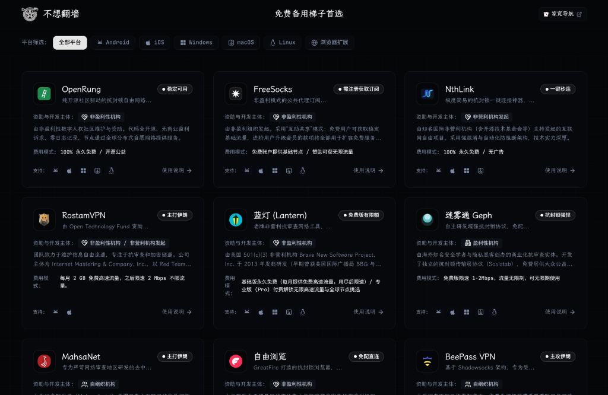

# 不想翻墙 — 备用梯子首选

收集的相对比较靠谱的、稳定的、免费的VPN/梯子🪜。

<p align="center">
  
</p>

## 🌟 核心收录工具与开发主体

| 工具名称 | 资助与开发主体 | 当前状态 | 平台支持 | 核心亮点 |
| :--- | :--- | :--- | :--- | :--- |
| **1. OpenRung** | `[非盈利性机构]` | 🟢 稳定可用 | Android, iOS, Win, Mac, Linux | 开源无日志，免注册，一键握手，附 GitHub APK 直链与 TestFlight |
| **2. FreeSocks** | `[非盈利性机构]` | 🟢 稳定可用 | Android, iOS, Win, Mac, Linux | 公共互助订阅源，免费获取基础节点，兼容各大主流通用客户端 |
| **3. NthLink** | `[非营利机构发起]` | 🟢 稳定可用 | Android, iOS, Win, Mac | 极度简易一键秒连，提供国内免翻镜像 (downloadnth & AWS S3) |
| **4. 蓝灯 (Lantern)** | `[非盈利性机构]` | 🟢 免费版有限额 | Android, iOS, Win, Mac, Linux | 早期获 BBG/OTF 资助，智能分流省流量，集成自研混淆与多协议动态抗阻断，无需注册一键直连 |
| **5. BeePass VPN** | `[自组织机构]` | 🟢 主攻伊朗 | Android, iOS | Shadowsocks 架构，专为受限地区研发的抗封锁工具，支持 Telegram 与邮件自动获取节点，附官方 X |
| **6. Ceno** | `[非盈利性机构]` | 🟢 很慢但能用 | Android, iOS, Win | 加拿大 eQualitie 研发，基于 P2P 与 Ouinet 分布式缓存，附 censorship.no 备用镜像 |
| **7. 迷雾通 Geph** | `[盈利性机构]` | 🟢 稳定可用 | Android, iOS, Win, Mac, Linux | 自研 Sosistab 深度抗审查混淆，免费版无限流量，极强穿透力 |
| **8. 1.1.1.1** | `[商业机构]` | 🟢 稳定可用 | Android, iOS, Win, Mac, Linux | Cloudflare 全球 Anycast 骨干通道，提供大陆优选 IP 指导 |
| **9. Cloudflare One**| `[商业机构]` | 🟢 稳定可用 | Android, iOS, Win, Mac, Linux | 企业级零信任通道，个人享受 50 席位免费配额，通道优先级高 |
| **10. Tor Browser** | `[非盈利性机构]` | 🟡 国内需配网桥 | Android, iOS, Win, Mac, Linux | 顶尖匿名防御，普林斯顿大学直连镜像，内置 Snowflake/电报申请网桥与开源社区网桥源 |
| **11. Proton VPN** | `[非盈利性机构监督]` | 🟢 稳定可用 | Android, iOS, Win, Mac, Linux, 扩展 | 瑞士中立国法律管辖，免费无限流量，指引切换 Stealth 隐形协议 |

## 🛠️ 内容管理台（CMS）

站点内置了一套与主站同样暗色风格的内容管理台，不绑定固定域名：

- 任意已绑定到本站的域名后加 `/dtms` 即可访问，例如 `https://bxfq.sld.tw/dtms`
- 本地开发访问 `http://localhost:5173/dtms`
- 其他备用域名（如 `*.pages.dev`）同样使用 `/dtms`，无需额外配置

### 可管理的内容

- **所有项目**：新增、编辑、删除、排序，以及完整字段（基础信息、平台、下载链接、镜像站、网桥、快速上手、详细指南、联系方式等）
- **项目展示状态**：
  - `可见`：在网站中正常展示
  - `暂不可用`：在网站中以灰色置灰展示，详情页可查看原因
  - `隐藏`：完全不出现在网站中，直达链接也会失效
- **页脚**：简介、链接（含「小白避坑手册」入口）、备份网址、免责声明与标语
- **小白避坑手册**：标题、副标题以及每条避坑内容（支持 `**加粗**` 与 `[文字](链接)`）
- **导航栏「家宽导航」按钮**：显示/隐藏、文字、链接、Logo 与悬停提示

### 内容存储与提交

- 全部内容集中保存在 `src/data/content.json`，网站构建时直接读取，CMS 修改后提交的也是这个文件。
- 打开 CMS 会自动从 GitHub 读取最新内容；读取失败时回退到当前构建内置的版本，仍可继续编辑。
- 未提交的编辑会自动保存为浏览器本地草稿，刷新或跳转后自动恢复；也可以随时「放弃草稿」。
- 提交更改需要 GitHub Personal Access Token（PAT）：
  - 推荐 Fine-grained token，仅授权 `kanpianer/bxfq` 仓库的 **Contents: Read and write** 权限
  - 或经典 token，勾选 `repo` 权限
  - PAT 仅保存在当前浏览器的 `localStorage`，不会上传到除 GitHub API 以外的任何服务器
- 仓库、分支与内容文件路径可在 CMS「设置」中修改，方便 Fork 部署后使用。
- 提交后由 Cloudflare Pages 等托管平台自动重新构建，全站及所有备用域名同步生效。

### 部署提示

`public/_redirects` 已为 Cloudflare Pages / Netlify 配置 `/dtms` 的 SPA 回退。若使用其他静态托管平台，请将 `/dtms` 重写到 `/index.html`，否则直接访问可能返回 404。

## 🚀 快速上手与运行

### 1. 开发模式
```bash
npm install
npm run dev
```

### 2. 生产预览
```bash
npm run preview
```
访问本地地址：`http://localhost:5173/`

### 3. 构建发布
```bash
npm run build
```
打包输出目录为 `dist/`，可一键部署至 Cloudflare Pages、Vercel、GitHub Pages 等任意静态托管平台。
